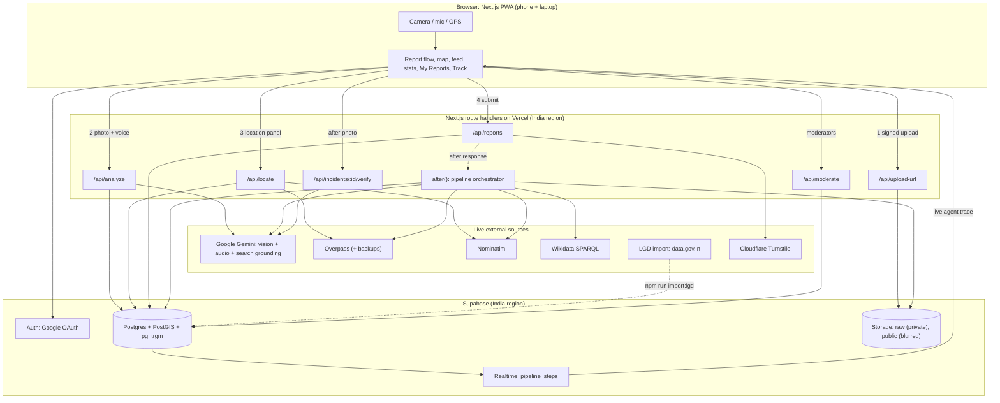
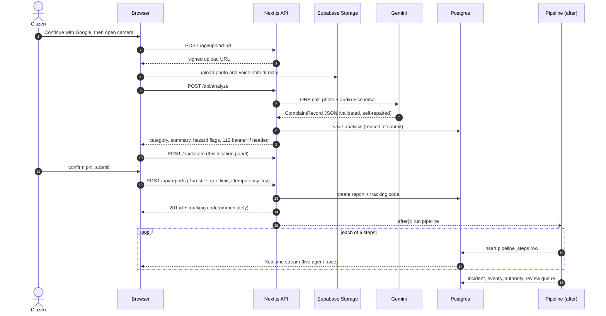
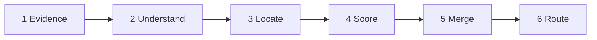
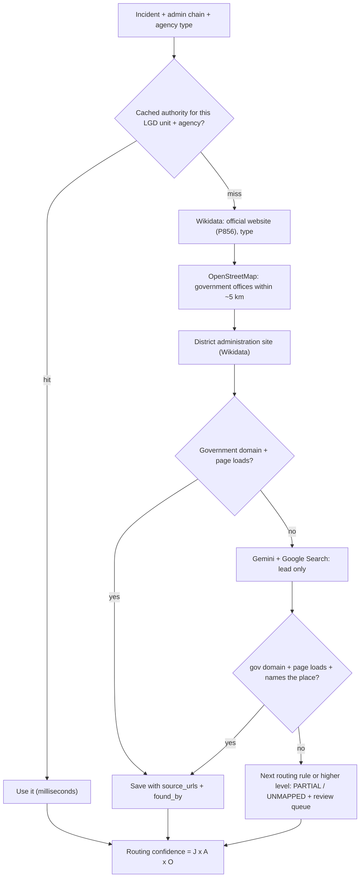
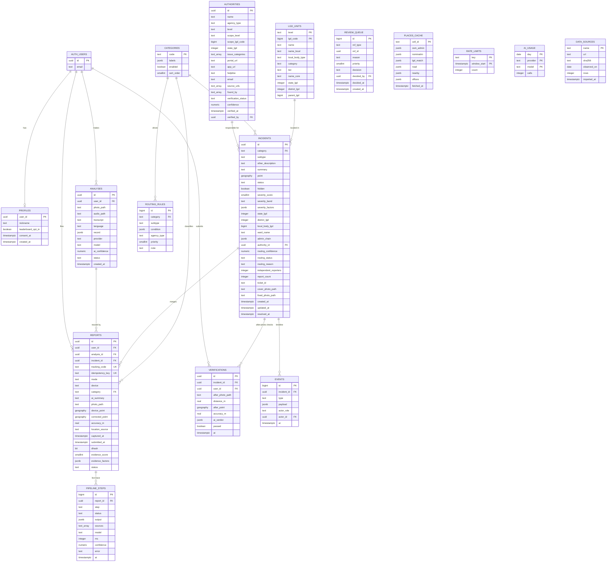
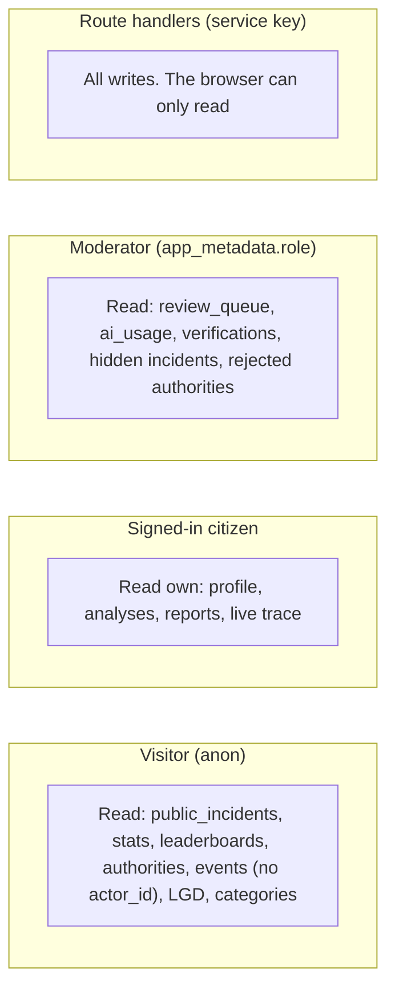
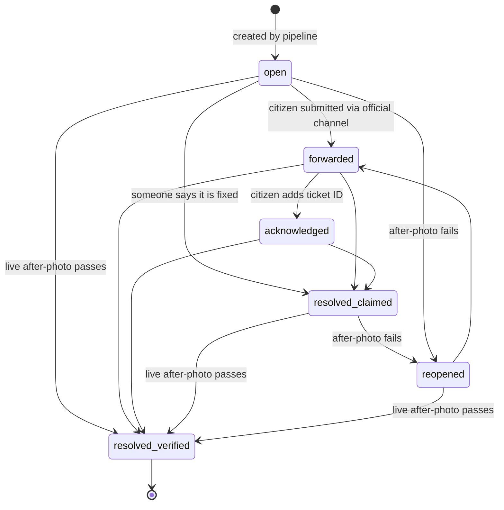

# NagarNetra

**One report. The right authority. Public accountability.**

NagarNetra is an India-wide AI civic triage and accountability platform. A citizen photographs a civic problem (pothole, garbage, leak, streetlight, dangerous wire, pollution), optionally speaks about it in any Indian language, and confirms the location. NagarNetra works out **who is responsible at that exact spot**, scores how serious it is, merges duplicate reports, and tracks whether the problem is *really* fixed, with a source shown for every fact.

> Built for the **Forge Gen AI Buildathon**, Theme 1: *Civic Pulse, Digital Governance & Public Information*, problem statement: **Transparent Civic Grievance & Infrastructure Triage System**.

| | |
|---|---|
| **Live app** | https://nagarnetra-omega.vercel.app/ (best on a phone; on a laptop use the webcam or Assisted mode) |
| **Licence** | Apache-2.0 |

> Judges: the access code for the moderator console is in the private submission form, never in this repository.

---

## Table of contents

1. [Problem statement](#1-problem-statement)
2. [Solution overview](#2-solution-overview)
3. [System architecture](#3-system-architecture)
4. [The six-step AI pipeline](#4-the-six-step-ai-pipeline)
5. [Database design](#5-database-design)
6. [Scoring and routing logic](#6-scoring-and-routing-logic)
7. [Incident lifecycle and verified resolution](#7-incident-lifecycle-and-verified-resolution)
8. [Security, privacy and abuse protection](#8-security-privacy-and-abuse-protection)
9. [API reference](#9-api-reference)
10. [How this meets the evaluation criteria](#10-how-this-meets-the-evaluation-criteria)
11. [Tech stack and data sources](#11-tech-stack-and-data-sources)
12. [Setup and installation](#12-setup-and-installation)
13. [Testing](#13-testing)
14. [Project structure](#14-project-structure)
15. [Limitations and roadmap](#15-limitations-and-roadmap)
16. [Licence and attribution](#16-licence-and-attribution)

---

## 1. Problem statement

### Target issue and context

Across India, civic problems stay unresolved partly because **reporting is broken**:

- **Responsibility is fragmented.** Roads, drains, lights, garbage and wires belong to municipal corporations, municipalities, nagar panchayats, gram panchayats, district administrations, state departments, power utilities and national agencies such as NHAI. Who owns what changes from place to place.
- **Citizens don't know where to go.** Every body has its own portal, app or helpline.
- **Complaints are unstructured.** They arrive as photos and voice notes in many languages.
- **Duplicates swamp the queue.** The same pothole is reported dozens of times.
- **Nothing separates a hairline crack from an open manhole.** Triage is manual and inconsistent.
- **Issues get closed without proof.** "Resolved" often means "marked resolved".

### Target audience

Any citizen in India, including people who don't speak English and people who prefer to speak rather than type, plus resident groups, civic volunteers and local officials who need a de-duplicated, prioritised, evidence-backed queue.

### Why it matters (Theme 1)

It modernises public-service delivery and closes the information gap between citizens and institutions: hazards reach the right body faster, duplicate work drops, and institutional performance becomes publicly measurable.

---

## 2. Solution overview

> **The LLM perceives, rules decide, sources prove, humans confirm.**

NagarNetra is a responsive web app (phone and laptop, no install) with **nothing about any place hardcoded**. Everything about a location is discovered live from the reporter's GPS point and shown with its source.

### What a citizen can do

1. **Report** with a live in-app camera photo, an optional voice note, and GPS with an accuracy circle and a correctable pin. Sign-in with Google is required to report.
2. **See the analysis** before submitting: detected issue, summary in their own language, location.
3. **Watch the agent work** through a live trace of each pipeline step.
4. **Act**: see the responsible authority with sources and contact channel, mark the report *Forwarded*, add the *ticket ID*.
5. **Verify the fix** with a live after-photo taken at the same spot.
6. **Track** any report with a short code (`NN-7K3Q9P`) or from *My Reports* on any device.

Anyone, without signing in, can browse the public map, the issue feed, stats and leaderboards.

### What makes it different

| Typical civic app | NagarNetra |
|---|---|
| Fixed city list and a hand-curated office directory | No place is pre-loaded. Boundaries, local body and authority are **discovered live** and cached with citations |
| Chatbot or form that forwards a complaint | Multi-step agent with tool use (OpenStreetMap, Nominatim, Wikidata, official directory, web search), validation, self-repair and model fallback |
| LLM decides severity | **Hard safety rules decide**; the LLM only describes what it sees |
| "Resolved" = someone clicked a button | **Claimed** and **verified** resolution are different states; only a live after-photo at the spot can verify |
| Opaque | Three separate scores (Severity, Evidence, Routing confidence), each explained |

### Agentic behaviour

- Multi-step tool use across six logged pipeline steps, streamed live to the browser.
- Structured output validated by a schema, with **one self-repair attempt**, then a **fallback model**, then a graceful *analysis pending* mode. The citizen is never blocked by the AI.
- **Authority Finder**: cache, then Wikidata, then OpenStreetMap government offices, then Gemini with Google Search as a last resort. A result is accepted only if it is a government domain, the page loads, and it names the place. Page text is only checked in code, never fed back to a model (prompt-injection guard).
- Clarifying behaviour: low-confidence AI shows a category picker; unclear cases go to a human review queue.

---

## 3. System architecture



### Request flow for one report



---

## 4. The six-step AI pipeline

Every report runs through these steps after the response is sent. Each step writes a row to `pipeline_steps`, which Supabase Realtime streams to the browser as the **live agent trace**. A failing step is logged and the pipeline continues with what it has.



| Step | What it does | If it fails |
|---|---|---|
| **1 Evidence** | Perceptual hash (dHash) reuse check; blurs faces and number plates; strips EXIF; saves a public WebP copy | Never blocks; lowers the Evidence score |
| **2 Understand** | Reuses the analysis made at preview (no second AI call): category, hazard flags, summary, transcript | Analysis missing, so the report goes to a *pending* queue with the citizen's chosen category |
| **3 Locate** | Overpass `is_in` boundaries, nearest road, nearby schools/hospitals/bus stops, Nominatim address; fuzzy-matched to the official LGD; cached per ~100 m cell | Timeouts, backup Overpass servers, Nominatim fallback, falls back one admin level |
| **4 Score** | Severity (rules + hard floors) and Evidence strength, pure TypeScript, unit-tested | n/a |
| **5 Merge** | Finds an open incident of the same category nearby using geo distance, image similarity and text similarity | Grey zone creates a new incident; same user twice returns *already reported* |
| **6 Route** | Rules give the agency type; cache or Authority Finder finds the actual body; domain check; routing confidence | `PARTIAL` (higher-level channel) or `UNMAPPED`, then the review queue |

### Authority Finder



The authority registry **starts empty** and builds itself from real reports; every row stores its source URLs and how it was found (`wikidata`, `osm`, `web_search`, `moderator`).

### Unknown and random images

The vision call also decides whether the photo is a civic problem at all.

| Case | What happens |
|---|---|
| Not civic (selfie, food, screenshot, indoor room) | Polite refusal; retake or use Assisted mode. No incident created |
| Poor quality | Retake hint (for example "move back", "turn on flash") |
| Civic but outside the six categories | Saved as `other_civic` with the AI's description, routed to the local body, sent to review |
| Private property | Explained refusal, unless a hazard threatens a road or footpath |
| Low confidence | Category picker with the AI's guess preselected |
| Any hazard flag | Safety floor applies; **Critical** and the **112 banner** |

---

## 5. Database design

PostgreSQL with **PostGIS** (geography points, spatial radius search), **pg_trgm** (fuzzy name and text matching), Row Level Security on every table, Supabase Storage and Realtime. The schema lives in [`supabase/migrations/`](supabase/migrations/) (15 migrations).

### Entity-relationship diagram



`LGD_UNITS` is linked to incidents by code columns (`state_lgd`, `district_lgd`, `local_body_lgd`), not by a foreign key, because LGD codes are only unique within a level. `PLACES_CACHE`, `RATE_LIMITS`, `AI_USAGE` and `DATA_SOURCES` are standalone support tables.

### Tables by purpose

| Group | Tables | Notes |
|---|---|---|
| **National reference data** (location-neutral) | `lgd_units`, `categories`, `routing_rules`, `data_sources` | `lgd_units` is imported from the official Local Government Directory (about 300,000 rows). `categories` and `routing_rules` are product logic with no place names |
| **Live discovery caches** (start empty) | `places_cache`, `authorities` | Self-building. Every authority row carries `source_urls`, `found_by` and a `verification_status` of `ai_found`, `human_verified` or `rejected` |
| **People** | `profiles` | Created by a trigger on `auth.users`. Holds only a nickname (`Citizen #1234`), leaderboard opt-in and consent time. No email or Google name is copied here |
| **Reporting** | `analyses`, `reports`, `incidents` | One AI analysis per photo (reused on submit); a report is one submission; an incident is one real-world problem that many reports can merge into |
| **Workflow and logs** | `pipeline_steps`, `events`, `verifications`, `review_queue` | `events` is the append-only public timeline; `verifications` holds after-photo checks; `review_queue` is the moderator worklist |
| **Guards** | `rate_limits`, `ai_usage` | Atomic rate-limit RPC and per-model daily AI call counter, both server-only |

### Key constraints and indexes

| Constraint | Purpose |
|---|---|
| `reports.idempotency_key` UNIQUE | A retried submit (for example airplane mode mid-submit) can never create a duplicate |
| `reports.tracking_code` UNIQUE | Short shareable code that avoids look-alike characters |
| UNIQUE `(incident_id, user_id)` on reports | One report per person per incident ("You already reported this") |
| UNIQUE NULLS NOT DISTINCT `(agency_type, scope_level, scope_lgd_code)` on authorities | One cached answer per agency type and place |
| UNIQUE partial index on `review_queue (ref_type, ref_id, reason)` where open | The same open item is never queued twice |
| `reports_has_location` CHECK | A report needs a device or corrected point |
| GiST index on `incidents.point` | Fast radius search for duplicate merge |
| GIN trigram indexes on `lgd_units.name_core`, `lgd_units.name` and `incidents.summary` | Fuzzy name matching and text similarity |
| `reports.user_id` ON DELETE SET NULL | Deleting an account unlinks reports; incidents stay as anonymous public records |

### Database functions (RPCs)

| Function | What it does | Access |
|---|---|---|
| `match_lgd(level, core_name, state, district, limit)` | Trigram match of an OSM name to official LGD units; local bodies are restricted to the lowest tier (city bodies or village panchayats, never district or block panchayats) | public |
| `merge_candidates(lat, lon, radius, category, summary, hash, user)` | Open incidents of the same category within the radius, with distance, text similarity, best image bit-distance and a same-user flag | server only |
| `similar_photos(hash, exclude, max_bits)` | Earlier reports whose photo is nearly identical (reuse detection) | server only |
| `check_rate_limit(key, window, max)` | Atomic `INSERT ... ON CONFLICT` counter | server only |
| `record_ai_call(provider, model)` | Counts one AI call and returns today's total | server only |
| `citizen_leaderboard(limit)` | Opt-in nickname and points only | public |
| `is_moderator()` | Reads `app_metadata.role` from the JWT | RLS helper |
| `generate_tracking_code()`, `handle_new_user()`, `touch_updated_at()` | Tracking codes, profile creation trigger, `updated_at` trigger | internal |

### Public views (no reporter columns)

`public_incidents`, `public_stats`, `stats_by_category`, `stats_by_state`, `place_leaderboard`, `authority_leaderboard`. All are `security_invoker`, so hidden incidents stay hidden. Every number on the stats pages is **live SQL** over real rows. Leaderboards only rank places or authorities with at least 3 incidents.

### Row Level Security model



The browser never writes to the database directly. Every write goes through a route handler that checks the session first and then uses the server-only secret key. `places_cache` and `rate_limits` have no policies at all, so they are reachable only from the server. `events.actor_id` is hidden from public readers by column privileges.

### Storage buckets

| Bucket | Visibility | Contents |
|---|---|---|
| `raw` | **private**, 10 MB limit | Original photos and voice notes (uploaded with server-signed URLs) |
| `public` | public, 2 MB limit, WebP only | Blurred, EXIF-stripped photos shown on incident pages |

---

## 6. Scoring and routing logic

Three separate scores appear on every incident, so a case can honestly read: *"Critical severity · Strong evidence · Partial routing, and here is why."*

### Severity (rules decide, not the LLM)

```
score = 100 x (0.40 x Damage + 0.30 x LifeRisk + 0.15 x RoadImportance + 0.15 x Exposure)

Damage          none 0 · minor 0.25 · moderate 0.5 · major 0.75 · severe 1.0
LifeRisk        any hazard flag 1.0 · pedestrians/footpath 0.5 · on road 0.4 · otherwise 0.15
RoadImportance  OSM class (motorway/trunk/NH 1.0 down to residential 0.3); blocks traffic 0.8
Exposure        schools/hospitals/bus stops within 200 m (Overpass) + pedestrians nearby

Bands:  >= 75 Critical · 55-74 High · 35-54 Medium · < 35 Low
final band = max(hard floor, computed band)
```

| Hard safety floor | Result |
|---|---|
| Live or fallen wire, open manhole or pit, burst main, collapse risk | **Critical** |
| Fire or open burning, sewage overflow, flooding | at least **High** |

### Evidence strength

| Signal | Points |
|---|---|
| Live in-app capture (Assisted = 0) | +30 |
| GPS accuracy within 50 m (+10 if within 150 m) | +20 |
| Submitted within 10 minutes of capture | +15 |
| Image not seen before (dHash) | +15 |
| Scene fits the place (public space, inside India) | +10 |
| Corroborated by a different user | +10 |

`>= 70` Strong · `40-69` Moderate · `< 40` Weak, which is flagged for review and never called "fake".

### Routing: which agency type?

| Category and context | Agency type |
|---|---|
| Road damage on a road with an `NH` ref | National highway authority |
| Road damage on an `SH` road | State PWD |
| Road damage on any other road | Local body |
| Garbage, streetlight | Local body |
| Water leak or sewer | Water board if one is found for that place, otherwise local body |
| Electrical hazard | State electricity distribution company |
| Open burning or pollution | State pollution control board (waste burning also goes to the local body) |
| Anything else civic (`other_civic`) | Local body, then human review |

### Routing confidence

```
RoutingConfidence = J x A x O

J  jurisdiction  local body matched 1.0 · district 0.8 · state 0.55 · none 0.2
A  authority     human-verified 1.0 · AI-found with a working gov site 0.85 · none 0.35
O  rule fit      best rule 1.0 · fallback rule 0.9 · other_civic 0.6

>= 0.75 VERIFIED · 0.40-0.74 PARTIAL · < 0.40 UNMAPPED
```

### Duplicate merge

Search radius = `clamp(25 m + GPS accuracy, 25, 100)`. Among open incidents of the same category inside it:

```
D = 0.40 x geo + 0.35 x image + 0.25 x text      (merge when D >= 0.55)
geo   = 1 - distance / radius
image = 1 - dHash bit-distance / 32     (neutral 0.3 when no hash)
text  = pg_trgm similarity of the AI summaries
```

The same citizen reporting the same incident again gets *"You already reported this"* with no score boost; `independent_reporters` counts **distinct accounts** only.

---

## 7. Incident lifecycle and verified resolution



| Level | What happened | How it is recorded |
|---|---|---|
| **Recommended** | Authority and channel identified | Automatic, with confidence and citations |
| **Forwarded** | Citizen submitted through the official channel | "I've submitted it" (self-attested) |
| **Acknowledged** | Authority issued a ticket | Citizen enters the ticket ID |
| **Resolved: claimed** | Someone says it is fixed | Self-attested, never counted as verified |
| **Resolved: verified** | Independently checked | Only a live after-photo can set this |

**How verification works:** the citizen must be within about 75 m (plus the photo's GPS accuracy, up to a 150 m total) of the original spot. Gemini compares the before and after photos: *same place?* and *problem actually fixed?* A pass sets `resolved_verified` and publishes a blurred after-photo in the "solved" gallery; a fail sets `reopened` with the reason shown. If the AI is down, the incident is **not** reopened; the citizen is asked to retry. Moderators **cannot** mark anything verified.

---

## 8. Security, privacy and abuse protection

| Area | What we do |
|---|---|
| **Authentication** | Google sign-in (PKCE, `@supabase/ssr`) is required to report. Viewing needs no login. Email and password exists only for the shared tester and judge accounts |
| **Roles** | Visitor, citizen, moderator. Enforced in Row Level Security **and** in every route, never only in the UI |
| **Identity** | `user_id` always comes from the server session, never from the request body. Google email, name and avatar stay in `auth.users` and are never shown publicly |
| **Privacy by design** | Public sees: blurred photo, category, AI summary, severity, timeline, authority and sources, area. Private: reporter identity, device GPS, raw audio, raw transcript, unblurred media |
| **Media** | Faces and number plates blurred, EXIF stripped, ~WebP re-encode before anything becomes public |
| **Account deletion** | `DELETE /api/me` removes audio and transcripts and unlinks reports; incidents stay public and anonymous |
| **Spam and abuse** | Cloudflare Turnstile on submit; per-user limits (5/hour, 20/day) and per-IP limit (10/hour); idempotency keys; reused-photo detection; one report per person per incident |
| **Live-capture rules** | Live reports need a photo taken within 15 minutes; the pin may only fine-tune GPS (it cannot move a report elsewhere); India bounds enforced |
| **Emergency safety** | Not an emergency service. Hazard words and AI hazard flags show **"If anyone is in danger, call 112"** immediately, before any AI result |
| **Prompt-injection guard** | Web page content is only checked in code for names; it is never given to a model |
| **Moderator limits** | Cannot see reporter identity, cannot mark a fix verified; every action is written to `events` |
| **In-app browsers** | Instagram/Facebook in-app browsers (which Google blocks) are detected and the user is told to open Chrome or Safari |
| **Honest about live capture** | Browsers can't prove an image is live or that GPS isn't spoofed. Live capture is a **trust signal** that feeds the Evidence score, not proof |

---

## 9. API reference

All write routes require a signed-in user. Browser clients only read from the database; writes happen in these handlers.

| Route | Auth | Purpose |
|---|---|---|
| `GET /auth/callback` | none | Google OAuth code, session cookie, redirect |
| `POST /auth/demo` | code for judge | One-tap sign-in to shared tester or judge accounts |
| `POST /api/upload-url` | user | Signed upload URL for photo, voice note or after-photo (bypasses the serverless body limit) |
| `POST /api/analyze` | user | One Gemini call (photo + audio) returns a validated `ComplaintRecord`; saved to `analyses` |
| `POST /api/locate` | public, rate-limited | "This location" panel: admin chain, road, nearby places, offices, with sources |
| `POST /api/reports` | user | Turnstile, rate limits, idempotency, creates report and tracking code, runs the pipeline in `after()` |
| `GET /api/track/[code]` | public | Status for a tracking code |
| `GET /api/me/reports` | user | My Reports (any device) |
| `GET/DELETE /api/me` | user | Who am I / delete my account |
| `POST /api/me/profile` | user | Nickname, leaderboard opt-in, consent |
| `GET /api/incidents` | public | Incidents for the map |
| `GET /api/incidents/[id]` | public | One incident with timeline |
| `GET /api/feed` | public | Open or solved feed with filters (category, severity, state) |
| `POST /api/incidents/[id]/status` | reporter or moderator | Forwarded, acknowledged, resolved-claimed, ticket ID |
| `POST /api/incidents/[id]/verify` | user | After-photo check, resolved-verified or reopened |
| `POST /api/incidents/[id]/reroute` | reporter or moderator | Search for the responsible authority again |
| `GET /api/stats`, `GET /api/leaderboard` | public | Live numbers and leaderboards |
| `POST /api/moderate` | moderator | Approve or fix an authority, fix category, hide, merge, close a queue item |

---

## 10. How this meets the evaluation criteria

| Pillar | How NagarNetra answers it |
|---|---|
| **Technical architecture and engineering depth (20)** | Typed Next.js codebase split into `lib/ai`, `lib/discovery`, `lib/pipeline`, `lib/rules`, `lib/guards`, `lib/media`. PostGIS spatial search, trigram fuzzy matching against the national directory, perceptual image hashing, RLS-enforced roles, Realtime streaming, signed direct-to-storage uploads, idempotent writes. 15 migrations, unit tests for the rules, database tests for RLS and the pipeline |
| **AI reasoning and agentic execution (25)** | Six-step logged pipeline; schema-validated Gemini output with self-repair and a fallback model; Authority Finder with multi-source discovery and domain verification; separation of *perception* (LLM) from *decision* (rules) to minimise hallucination; source attribution on every discovered fact; graceful *analysis pending* mode |
| **Problem relevance, impact and USP (25)** | Directly implements the "Transparent Civic Grievance and Infrastructure Triage" problem: visual and voice reports, automatic severity, routing to the right authority, public accountability dashboards. USP: a self-building, source-cited map of who is responsible for what, plus verified (not claimed) resolution. Apache-2.0 digital public good that any city or NGO can deploy |
| **Live demonstration and robustness (30)** | Runs on a deployed URL against live backends. Edge cases handled: blurry or irrelevant photos, GPS denied or inaccurate, duplicate submits, rate limits, both AI models down, slow public map APIs (backups, timeouts, cache), in-app browsers, non-government websites |

### Compliance with the strict rules

| Rule | How we comply |
|---|---|
| **No dummy data** | No hardcoded JSON, mock datasets or placeholder numbers. The app reads from a live database and live APIs (OpenStreetMap, Nominatim, Wikidata, Gemini) and the official LGD dataset. The authority registry starts empty; all dashboard numbers are live SQL over real reports |
| **Open source and boilerplate** | Open-source libraries only. Core logic, AI workflows, pipeline and rules were written during the hackathon window |
| **Code ownership** | Every module and the data flow are documented here and in code comments |
| **No pre-recorded or mock demo** | The demo is recorded on the live URL |

---

## 11. Tech stack and data sources

| Layer | Choice |
|---|---|
| App and API | Next.js (App Router, TypeScript), React, Tailwind CSS, route handlers, `after()` for background work |
| Hosting | Vercel (function region `bom1`, Mumbai) |
| Database | Supabase Postgres with PostGIS and pg_trgm |
| Auth | Supabase Auth with Google OAuth (PKCE, `@supabase/ssr`) |
| Media | Supabase Storage, `sharp` (resize, WebP, blur, EXIF strip, dHash) |
| AI | Google Gemini via `@google/genai`: vision and audio in one call, JSON-schema output, primary plus fallback model, Google Search grounding for the Authority Finder |
| Validation | `zod` |
| Maps | MapLibre GL |
| Geo and knowledge | Overpass (with backup instances), Nominatim, Wikidata SPARQL |
| Abuse control | Cloudflare Turnstile, Postgres rate-limit table |
| Testing | Vitest, SQL tests run in a throwaway PostGIS container |

### Data sources and licences

| Source | Used for | Licence |
|---|---|---|
| Local Government Directory (LGD), imported from official daily exports | Official names, codes and types of every state, district, sub-district, block and local body | Government Open Data Licence, India |
| OpenStreetMap via Overpass and Nominatim | Boundaries containing a point, nearest road, nearby schools/hospitals, government offices | ODbL, © OpenStreetMap contributors |
| Wikidata | Official websites and types of local bodies | CC0 |
| Google Gemini | Understanding photos and voice notes, comparing before and after photos | Google API terms |

Full details: [DATA_SOURCES.md](DATA_SOURCES.md). Cached data derived from OpenStreetMap stays under the ODbL if it is ever published.

---

## 12. Setup and installation

**Requirements:** Node.js 20+, npm, a Supabase project, a Google AI Studio key, a Google OAuth client, and (optionally) a Cloudflare Turnstile site. Docker is needed only for `npm run test:db`.

### 1. Clone and install

```bash
git clone <repo-url>
cd nagarnetra
npm install
cp .env.example .env.local   # then fill in the values below
```

### 2. Environment variables

| Variable | Purpose |
|---|---|
| `NEXT_PUBLIC_SITE_URL` | Public URL of the site (used for the Google sign-in redirect) |
| `NEXT_PUBLIC_CONTACT_EMAIL` | Shown on the Privacy and Terms pages |
| `NEXT_PUBLIC_SUPABASE_URL`, `NEXT_PUBLIC_SUPABASE_PUBLISHABLE_KEY` | Supabase project URL and publishable key |
| `SUPABASE_SECRET_KEY` | **Server only.** Bypasses RLS, never expose to the browser |
| `GEMINI_API_KEY` | Google AI Studio key |
| `GEMINI_MODEL_ANALYZE`, `GEMINI_MODEL_FALLBACK`, `GEMINI_MODEL_VERIFY` | Model names, so they can change without code changes (each model has its own quota) |
| `GEMINI_MODEL_SEARCH` | Optional model for the Authority Finder web search; falls back to the others |
| `NEXT_PUBLIC_TURNSTILE_SITE_KEY`, `TURNSTILE_SECRET_KEY` | Cloudflare Turnstile |
| `OVERPASS_URLS` | Comma-separated Overpass instances, primary first, then backups |
| `NOMINATIM_URL`, `OSM_USER_AGENT` | Nominatim endpoint and an identifying User-Agent with a contact |
| `TESTER_EMAIL`, `TESTER_PASSWORD` | Shared tester account (citizen powers only) |
| `JUDGE_EMAIL`, `JUDGE_PASSWORD`, `JUDGE_ACCESS_CODE` | Judge moderator account and its access code |

Never commit real values. Use separate Supabase and Google AI projects for development and production.

### 3. Database

```bash
npx supabase login
npx supabase link --project-ref <your-project-ref>
npx supabase db push
```

Enable the **PostGIS** and **pg_trgm** extensions (the first migration does this) and Realtime on `pipeline_steps` (the storage and realtime migration does this).

### 4. Google sign-in

1. Google Cloud: create an OAuth client (Web application). Publish the consent screen **"In production"** (basic scopes only) so judges and users are not blocked by "Testing" mode.
2. Add `https://<project-ref>.supabase.co/auth/v1/callback` as an authorised redirect URI.
3. Supabase, Auth, Providers: enable Google. Under URL configuration set the Site URL and add your redirect URLs (including `http://localhost:3000`).

### 5. Import the official local government directory

```bash
npm run import:lgd
```

Imports every state, district, sub-district, block and local body in India (about 300,000 rows, under a minute). Re-run any time to refresh.

### 6. Create tester and judge accounts (optional)

```bash
node --env-file=.env.local scripts/create-demo-accounts.mts
```

Set a moderator with `app_metadata.role = "moderator"`. Passwords and codes live only in server environment variables.

### 7. Run

```bash
npm run dev      # http://localhost:3000
npm run build && npm start
```

### Try the pieces without the app

```bash
npm run try:analyze -- photo.jpg [voice.webm] [--note "text"]   # photo / voice analysis
npm run try:locate                                              # live jurisdiction discovery for a point
```

### Deploy

Deploy to Vercel (`vercel.json` pins the Mumbai region), set the same environment variables, and add the Vercel domain to the Supabase redirect allow-list and the Turnstile site.

---

## 13. Testing

```bash
npm test          # Vitest: AI parsing and fallback, scoring rules, LGD name matching, OSM parsing, uploads, in-app browser detection
npm run test:db   # runs all migrations in a throwaway PostGIS container, then RLS and pipeline SQL tests
npm run lint
```

| Test | Covers |
|---|---|
| `lib/rules/score.test.ts` | Severity bands, hard floors, evidence scoring, routing confidence |
| `lib/ai/analyze.test.ts` | Schema validation, self-repair, fallback model order |
| `lib/discovery/*.test.ts` | LGD name normalisation, OSM response parsing |
| `supabase/tests/rls_test.sql` | A user cannot read another user's data; signed-out users cannot write; moderator-only tables |
| `supabase/tests/pipeline_test.sql` | Duplicate merge, same-user rule, radius and category checks |

---

## 14. Project structure

```
nagarnetra/
├── app/
│   ├── api/            analyze, upload-url, locate, reports, track, me, incidents, feed,
│   │                   stats, leaderboard, moderate
│   ├── auth/           callback, demo, signout
│   ├── report/         live and assisted report flow
│   ├── track/[code]/   public tracking page
│   ├── incident/[id]/  incident page
│   ├── issues/         public open / solved feed
│   ├── me/             My Reports, profile, delete account
│   ├── stats/          public stats and leaderboards
│   ├── moderate/       moderator console
│   └── privacy/ terms/ legal pages
├── components/         map, report flow, webcam, consent, Turnstile, track view
├── lib/
│   ├── ai/             schema.ts gemini.ts analyze.ts prompt.ts verify.ts find-authority.ts
│   ├── discovery/      osm.ts locate.ts lgd-names.ts
│   ├── pipeline/       run.ts (orchestrator)  route.ts (routing + Authority Finder)
│   ├── rules/          score.ts (severity, evidence, routing confidence)
│   ├── media/          image.ts (resize, WebP, blur, EXIF, dHash)  uploads.ts
│   ├── guards/         auth.ts rate-limit.ts turnstile.ts in-app-browser.ts
│   └── supabase/       client.ts server.ts admin.ts
├── supabase/
│   ├── migrations/     15 SQL migrations (schema, RLS, views, storage, RPCs)
│   └── tests/          rls_test.sql pipeline_test.sql
├── scripts/            import-lgd.mts create-demo-accounts.mts try-analyze.mts try-locate.mts test-db.sh
├── DATA_SOURCES.md
├── LICENSE             Apache-2.0
└── .env.example
```

---

## 15. Limitations and roadmap

### Known limitations

- **Live capture is a trust signal, not proof.** Browsers can't prove a photo is live or that GPS isn't spoofed; suspicious reports are flagged for review, not silently rejected.
- **Routing depth depends on what can be verified live.** Where OpenStreetMap boundaries or official websites are missing, the result is honestly marked `PARTIAL` or `UNMAPPED` and sent to a human, rather than guessed.
- **Laptop location is often inaccurate**, so the pin must be confirmed and the Evidence score reflects it. A phone gives the best result.
- **Free-tier AI quota is limited.** When both Gemini models are unavailable, reports are saved as *analysis pending* and the citizen picks the category.
- Public OpenStreetMap services can be slow; the app uses timeouts, backup Overpass servers and a ~100 m cache.

### Roadmap

- Explore mode: tap any point in India to see its jurisdiction and authority without filing a report
- India coverage view: how many local bodies per state have been discovered, AI-found versus human-verified
- Rain forecast (Open-Meteo) in the "This location" panel
- Hindi and other Indian-language UI
- Official API integrations with municipal grievance portals
- WhatsApp intake and auto-email to human-verified authorities
- Predictive risk models from accumulated, verified data

---

## 16. Licence and attribution

Licensed under the **Apache License 2.0**, see [LICENSE](LICENSE).

Map data © [OpenStreetMap contributors](https://www.openstreetmap.org/copyright) (ODbL). Local Government Directory data under the Government Open Data Licence, India. Wikidata under CC0. See [DATA_SOURCES.md](DATA_SOURCES.md).

Citizen reports, photos and locations are never stored in this repository.
